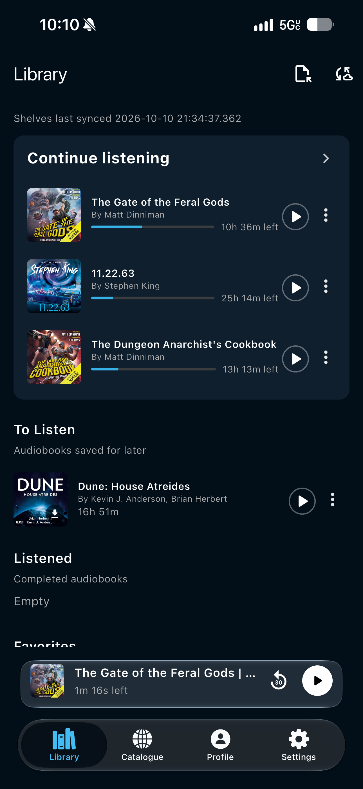
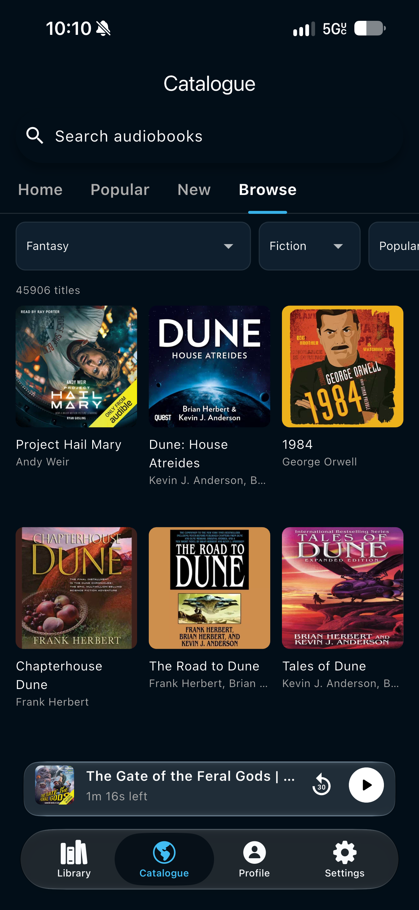
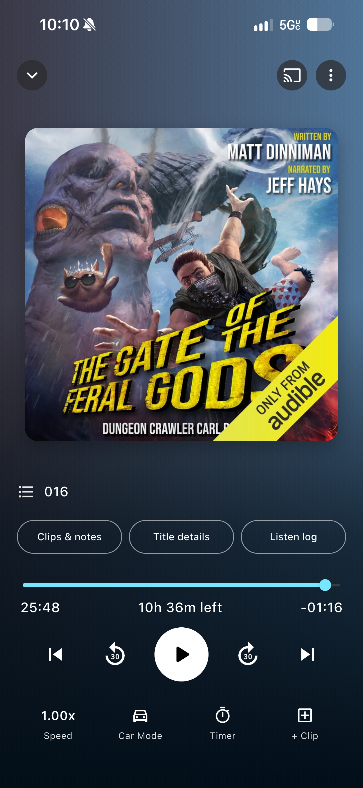
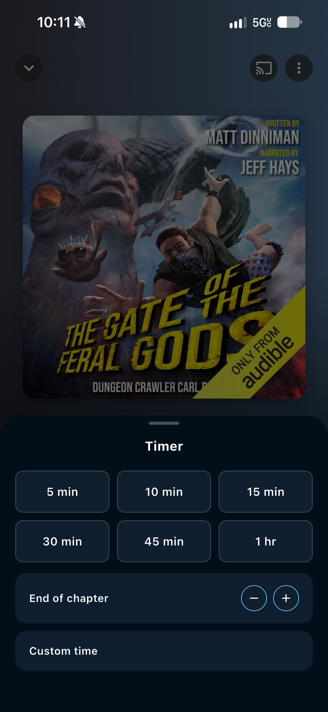
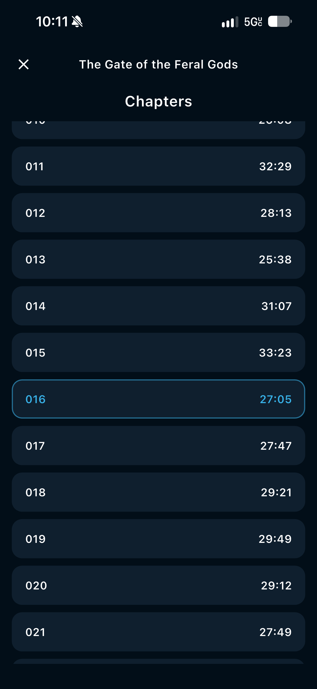
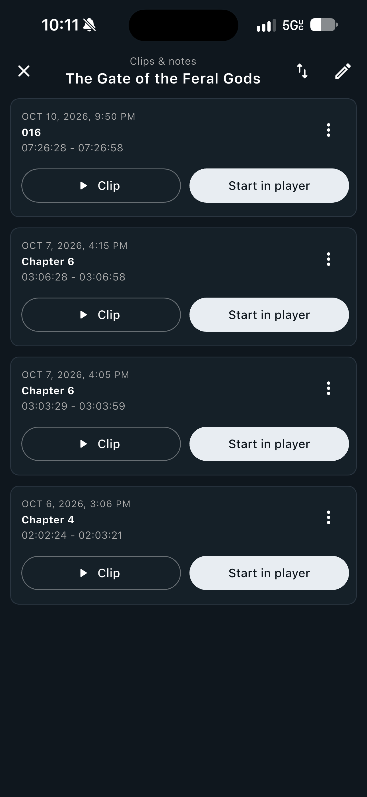
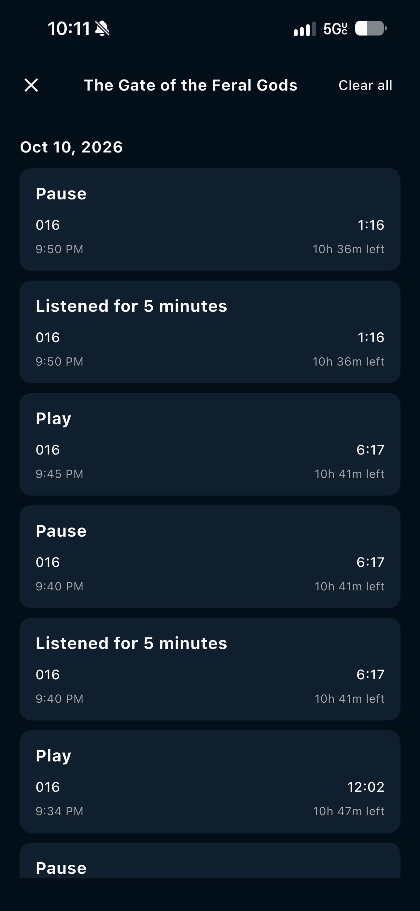
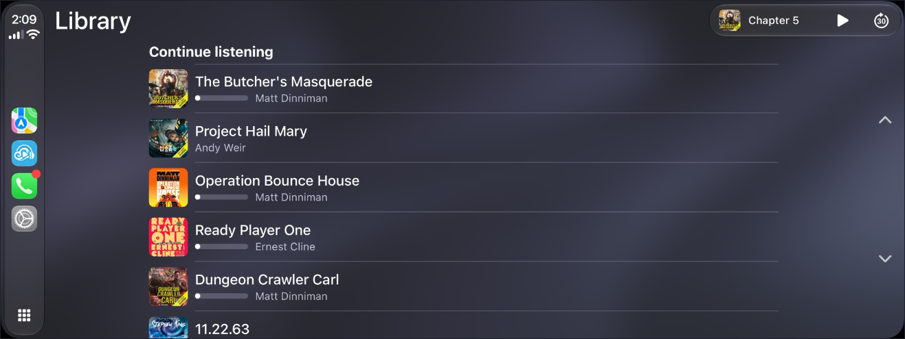
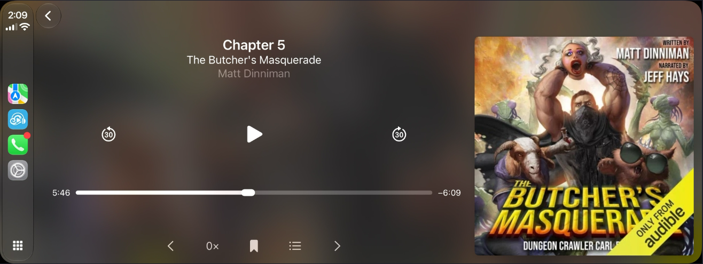

  

<h1 align="center">Cirrus</h1>

  <strong>Audiobook streaming for your library</strong> 
  Browse a huge catalogue, keep shelves in sync, and listen with a player built for long-form audio.

  <a href="https://github.com/Neighborhood-Nerd/cirrus/releases">Releases</a>
  ·
  <a href="https://github.com/Neighborhood-Nerd/cirrus/issues">Issues</a>
  ·
  <a href="https://github.com/Neighborhood-Nerd/soundloom-providers">Providers</a>
  ·
  <a href="https://discord.gg/ehTSarrwf">Discord</a>

---

## What is Cirrus?

Cirrus is a cross-platform audiobook app. Catalogue browsing and listening shelves come from [AudiobookDB](https://audiobookdb.org) — a community audiobook metadata catalog. Playback, downloads, and discovery are powered by installable sources (for example TorBox or Real-Debrid unlockers) plus optional JavaScript provider repos.

Your account syncs library state, shelves, and settings across devices. After the first sync, a local cache keeps catalogue and shelves usable offline.

## Features

- **Library shelves** — Continue Listening, To Listen, Listened, and Favorites, synced from AudiobookDB
- **Catalogue browse & search** — Home, Popular, New, and genre filters across tens of thousands of titles
- **Full audiobook player** — chapter skip, ±30s seek, speed control, sleep timer, car mode, and casting
- **CarPlay** — browse your library and control playback from the dashboard
- **Clips & notes** — bookmark moments and jump back into them later
- **Listen log** — see play/pause sessions and time spent for each title
- **Pluggable sources** — install provider repos and configure downloaders for cloud-unlocked audio
- **Cross-device sync** — library, shelves, and AudiobookDB key travel with your Cirrus account

## Screenshots

Phone and player screens are shown two per row so the README stays scannable on GitHub. Click any image to open it full size.

<table>
  <tr>
    <td align="center" width="50%">
       
      <strong>Library</strong>
    </td>
    <td align="center" width="50%">
       
      <strong>Catalogue</strong>
    </td>
  </tr>
  <tr>
    <td align="center">
       
      <strong>Now playing</strong>
    </td>
    <td align="center">
       
      <strong>Sleep timer</strong>
    </td>
  </tr>
  <tr>
    <td align="center">
       
      <strong>Chapters</strong>
    </td>
    <td align="center">
       
      <strong>Clips &amp; notes</strong>
    </td>
  </tr>
  <tr>
    <td align="center" colspan="2">
       
      <strong>Listen log</strong>
    </td>
  </tr>
  <tr>
    <td align="center">
       
      <strong>CarPlay — library</strong>
    </td>
    <td align="center">
       
      <strong>CarPlay — now playing</strong>
    </td>
  </tr>
</table>

## Download

Grab the latest build from **[Releases](https://github.com/Neighborhood-Nerd/cirrus/releases)**.

## Feedback & bugs

This repository is the public home for **Issues** and **Releases**.

- Report bugs or request features: [Open an issue](https://github.com/Neighborhood-Nerd/cirrus/issues/new)
- Browse existing reports: [All issues](https://github.com/Neighborhood-Nerd/cirrus/issues)
- Chat with the community: [Discord](https://discord.gg/ehTSarrwf)

## Related

- [soundloom-providers](https://github.com/Neighborhood-Nerd/soundloom-providers) — example / community provider manifests for installable sources
- [AudiobookDB](https://audiobookdb.org) — catalogue and shelves metadata

---

  Built by <a href="https://github.com/Neighborhood-Nerd">Neighborhood Nerd</a>

